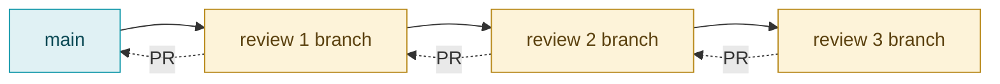

# gauntlet design

The Go implementation of gauntlet: run 56 specialized review prompts through installed
AI coding agents, which apply fixes directly to the working tree.

Reviews run sequentially in place, in parallel lane worktrees with serialized
merges, or in an isolated worktree that publishes a linear PR stack. Structured
events drive the dashboard, plain reporter, and run journal. Self-update and
hot reload let a long-running loop adopt a new binary at a review boundary.
See [CLI.md](CLI.md) for flags and [RUNS.md](RUNS.md) for operating guidance.

## Goals

1. Consistent review semantics across execution modes: composed prompts,
   injected rules, containment, and exit codes.
2. Parallel where it is safe: across directories always, and inside one
   directory only with isolated lane worktrees and a merge step.
3. A dashboard that reads like an instrument, not a log tail.
4. Fast: sub-100ms to first useful output, no measurable runner overhead
   against agent wall time.
5. One static binary that can update and reload itself.

## Non-goals

- Restricting agent reads, network access, or resource usage. The default
  kernel sandbox confines filesystem writes; hostile repositories still need
  a container for confidentiality and stronger isolation.
- Reimplementing agent CLIs. The runner is a scheduler and a screen.

## Package layout

| Package | Responsibility |
|---|---|
| `cmd/gauntlet` | flags, mode dispatch, preflights, help, and exit codes; the composition root |
| `cmd/sbom` | release-time CycloneDX inventory command |
| `internal/agent` | built-in and custom agent definitions, executable inventory, command construction, usage counters, and output protocol |
| `internal/prompt` | embedded prompts, project discovery, sets, composition, and fingerprints |
| `internal/evidence` | file-signal review suggestions from the tree, changelog, and run history |
| `internal/normalize` | output classification, deduplication, sanitization, home redaction, and clipping |
| `internal/gitx` | hardened git invocation, snapshots, status, line stats, branches, worktrees, and trailer cleanup |
| `internal/ghx` | bounded, argv-only GitHub PR lookup and creation through `gh` |
| `internal/runx` | child process groups, cancellation, bounded output and pipe waits, and absolute-only PATH resolution |
| `internal/runner` | scheduling, attempts, lanes, stacking, locks, commits, conflicts, sandboxing, events, and usage limits |
| `internal/journal` | JSONL journals, derived index, retention quarantine, restore, and history inspection |
| `internal/gauntlethome` | state-root resolution, path expansion, atomic writes, directory sync, and stale-temp cleanup |
| `internal/streamjson` | envelope-agnostic parsing of machine-readable agent output |
| `internal/ui` | dashboard and `pick` launcher |
| `internal/report` | plain event reporter, summaries, catalog columns, and terminal color policy |
| `internal/selfupdate` | release checks, verified download, atomic replacement, reload detection, and handoff |
| `internal/sbom` | release inventory from binary build info and module licenses |
| `internal/humanize` | duration and count parsing and formatting |
| `internal/envx` | shared interpretation of boolean environment variables |
| `internal/fuzzy` | NFC normalization, case folding, name suggestions, and collation |
| `internal/safefile` | guarded reads and appends: `O_NOFOLLOW`, regular-file checks, and nonblocking open to reject planted FIFOs |

`site/public` is a static project site, outside the Go build. Its inline CSS
shares the dashboard palette; `_headers` supplies its security policy and
`site/wrangler.jsonc` its deployment configuration. `cmd/gauntlet/site_test.go`
checks markup and color contrast.

The dependency graph is acyclic. `cmd/gauntlet` may compose any internal
package; no internal package imports `ui`. `TestInternalImportGraph` in
`cmd/gauntlet/layout_test.go` pins the following edges, including test imports:

| Package | Internal dependencies |
|---|---|
| `agent` | `fuzzy`, `gauntlethome`, `normalize`, `runx`, `safefile` |
| `evidence` | `fuzzy`, `gitx`, `journal`, `prompt` |
| `ghx` | `runx` |
| `gitx` | `runx`, `safefile` |
| `journal` | `gauntlethome`, `humanize`, `safefile` |
| `prompt` | `fuzzy`, `gitx`, `humanize`, `normalize`, `safefile` |
| `report` | `agent`, `envx`, `fuzzy`, `humanize`, `normalize`, `prompt`, `runner` |
| `runner` | `agent`, `evidence`, `fuzzy`, `gauntlethome`, `ghx`, `gitx`, `humanize`, `normalize`, `prompt`, `runx`, `streamjson` |
| `selfupdate` | `gauntlethome`, `safefile` |
| `sbom` | `runx` |
| `ui` | `envx`, `fuzzy`, `humanize`, `normalize`, `runner` |

The remaining packages have no internal dependencies. Shared process, display,
path, and file-open helpers keep their safety rules consistent across callers.
The picker receives the built-in suggester name through `PickConfig` rather
than importing `evidence`.

## External dependencies

Eight direct modules, with import sites constrained by tests:

| Module | Why it exists | Contained by |
|---|---|---|
| `charmbracelet/bubbletea` | dashboard event loop | imported by `internal/ui` only |
| `charmbracelet/lipgloss` | dashboard styling and adaptive color pairs | imported by `internal/ui` only |
| `muesli/termenv` | color-profile control for `--no-color`; lipgloss v1's profile API takes a termenv profile, so setting it means importing the type | `internal/ui.SetMonochrome` only |
| `maci0/toktop` | transcript token counts for agents that print none | `usage_toktop.go` in `internal/runner` and `transcript_toktop.go` in `cmd/gauntlet` only; build tag `-tags notoktop` drops both |
| `rivo/uniseg` | grapheme-cluster width, truncation, and segmentation so CJK and emoji remain intact and aligned | display paths in `internal/ui`, the plain reporter in `internal/report`, text truncation in `internal/normalize`, and the cell widths the CLI tests measure in `cmd/gauntlet` |
| `golang.org/x/text` | NFC normalization under fuzzy matching, the picker's filter, git ref and branch slugs, and the reload handoff's directory key. Prompt names and the file-signal suggester compose through `internal/fuzzy` rather than importing it themselves; their tests still import it to build the decomposed spellings they assert against | `cmd/gauntlet`, `internal/evidence`, `internal/fuzzy`, `internal/gitx`, `internal/prompt`, `internal/runner`, `internal/ui` |
| `golang.org/x/sys` | Landlock syscalls and ABI constants for filesystem write confinement | `internal/runner` only |
| `golang.org/x/term` | terminal detection and size before the TUI starts | `cmd/gauntlet` only |

No direct module is imported outside the column above, and no module is
imported without a row: `TestDirectModuleImportSites` and
`TestDesignDocumentsLinkedModules` hold both halves. The tables below are
the rest of what a release links in, none of it adopted and none of it
imported by name here. `TestLinkedModuleLicenses` reads the LICENSE file of
every row, so an upgrade that changes a license fails before it ships.

| Module | Why it links | Reached through |
|---|---|---|
| `charmbracelet/colorprofile` | maps a terminal profile onto lipgloss's renderer | `lipgloss`, `termenv` |
| `charmbracelet/x/ansi` | ANSI and SGR parsing for the styled dashboard output | `lipgloss`, `bubbletea` |
| `charmbracelet/x/cellbuf` | screen buffer and damage tracking behind `bubbletea`'s renderer | `bubbletea` |
| `charmbracelet/x/term` | terminal queries and raw-mode handling for the TUI | `bubbletea`, `colorprofile`, `x/cellbuf` |
| `aymanbagabas/go-osc52/v2` | writes the OSC 52 clipboard sequence termenv emits | `termenv` |
| `lucasb-eyer/go-colorful` | color-space conversion for lipgloss's adaptive pairs | `lipgloss` |
| `mattn/go-runewidth` | column width for the dashboard's tables | `bubbletea` |
| `mattn/go-isatty` | is-this-a-terminal checks behind the raw-mode switch | `termenv` |
| `muesli/ansi` | ANSI writer the standard renderer emits its updates through | `bubbletea` |
| `muesli/cancelreader` | interruptible reads so a repaint never eats a keystroke | `bubbletea` |
| `xo/terminfo` | terminal capability database behind colorprofile's profiles | `charmbracelet/colorprofile` |
| `klauspost/compress` | zstd decoder for dsh concatenated session logs | `toktop/agentusage`; `-tags notoktop` drops it |
| `modernc.org/sqlite` | crush/opencode keep counters in databases, not transcripts | `toktop`; `TAGS=` builds drop it; pure Go, so `CGO_ENABLED=0` cross-compilation is unaffected |
| `modernc.org/libc` | the cgo-free libc the pure-Go SQLite driver is built on | `modernc.org/sqlite` |
| `modernc.org/memory` | the allocator `libc` hands out | `modernc.org/libc` |
| `modernc.org/mathutil` | bit helpers for the big-integer arithmetic in `libc` | `modernc.org/libc` |
| `remyoudompheng/bigfft` | the transform behind the arbitrary-precision math in `libc` | `modernc.org/mathutil` |
| `ncruces/go-strftime` | the strftime the pure-Go `libc` provides itself where it cannot call the platform's C library, so the darwin build links it | `modernc.org/libc` |
| `dustin/go-humanize` | byte and time formatting inside the cgo-free libc | `modernc.org/libc`; `TAGS=` builds drop it |
| `google/uuid` | identifiers the cgo-free libc generates | `modernc.org/libc`; `TAGS=` builds drop it |

`go.mod` also requires `erikgeiser/coninput` and `mattn/go-localereader`, and
no shipped build links them: both are imported by bubbletea's
`key_windows.go`, and no release target is Windows. `go mod tidy` resolves
imports for every build configuration, including GOOS=windows, so a POSIX-only
release keeps two requires and compiles neither. They stay pinned and hashed
in `go.sum`, and no package in a released binary comes from them. The
inventory is the union over the platforms a release ships, not over the host
that reads it: `ncruces/go-strftime` links in the darwin build and not in the
Linux one, so `cmd/gauntlet/deps_test.go` resolves every target the dist
target publishes, and a row for either platform is never read as stale on the
other.

What the hand-rolled packages replace: `humanize`, `streamjson`, and `fuzzy`
exist because a general library for each would cost more in weight and
supply-chain surface than the few hundred lines they stand in for.

Supply-chain posture, and what any new dependency inherits as obligations:

- Every module is pinned to an exact version and verified against `go.sum`
  at build time. GitHub Actions are pinned by commit SHA, not tag.
  Runner images are pinned (`ubuntu-24.04`, `macos-15`), not `-latest`.
- Each release ships `checksums.txt` (the contract `gauntlet update` verifies
  downloads against), `sbom.json`, and `LICENSE`. The first two are what a
  consumer verifies the download against and what a scanner reads; the third
  is the text of the grant the binaries are offered under, which the AGPL
  asks a distributed work to carry and which a consumer who installed the
  binary alone has nowhere else to read. It is a copy of this repository's
  `LICENSE`, made by `make artifacts` and outside `checksums.txt` and the
  attestations, which cover the binaries.
- `sbom.json` is a CycloneDX 1.5 inventory of the
  modules the released binaries link, each with its `go.sum` hash and the
  SPDX identifier of the license it ships, under a subject component that
  carries the same grant (`AGPL-3.0-or-later`) and the released version. It
  is generated by `cmd/sbom`
  with the standard library alone, from the build info already inside each
  binary and the grant files in the module cache the build just filled, so
  the artifact describing the dependency surface adds nothing to it. The
  serial number is derived from the contents rather than drawn at random, so
  a rebuild produces the same document. A module whose license is not
  resolved, or whose `go.sum` hash the binary did not record, is named
  rather than guessed at or silently carried without its hash, and `cmd/sbom`
  fails the run before writing the document: `make artifacts` and the
  release that calls it stop, so no release ships an inventory that says
  nothing about the terms of a module it links, or lists a component a
  scanner has no hash to check it against. The hash half is what the
  `go:go.sum` property exists for: `buildinfo` records no hash for a
  module reached through a local-path or directory `replace`, so that is
  the case the check refuses.
- Every release also publishes a build-provenance attestation per binary
  (`actions/attest-build-provenance`, pinned by commit SHA, over the entries
  in `checksums.txt`), so a consumer can check with `gh attestation verify`
  which workflow and commit built what they downloaded. `gauntlet update`
  does not read it, which is R2 in `docs/THREAT_MODEL.md`.
- `go mod tidy -diff` runs as part of `make check`: a module left behind by
  a replacement is still downloaded and still hashed on every build, and
  nothing else notices one.
- A scheduled `govulncheck` job, plus one on every `go.mod`/`go.sum` change,
  reports vulnerabilities reachable from this code; dependabot owns version
  bumps, the scan owns advisories. Dependabot groups minor and patch bumps
  into one pull request and leaves a major version in its own, for the
  modules and for the actions alike, so neither pass is ever riding along
  with a routine bump. Tool versions inside `run:` steps are maintained separately. The Makefile
  owns their pins; workflow steps that repeat a pin are checked against it.
- Licenses of every linked module are MIT or BSD-3-Clause, compatible with
  this repo's AGPL-3.0-or-later. `TestLinkedModuleLicenses` reads the grant
  of every module a shipped build links, transitive ones included, so a
  version bump that changes a license fails the suite. It reads it from
  `sbom.LicenseFileNames()`, the same names the inventory reads, so a grant
  filed under a name this gate did not know passed here and stopped the
  release instead.
- One third-party package is fetched and executed without being linked, so
  it is in no module table and in no `sbom.json`: naming `dsh` with no
  launcher on `PATH` runs `bunx` against `agent.DshNpmPackage`, an exact
  version of the npm package the registry serves. The version is pinned in
  the source rather than resolved at fetch time, and the same constant is
  what `gauntlet doctor` prints, so there is one spelling of it; a `dsh:<model>`
  pin runs that argv as `--dump-config` before the review. What is not
  verified is the publisher, which is R5 in `docs/THREAT_MODEL.md`.
- The sqlite driver tracks upstream SQLite closely; when auditing, read the
  `SQLITE_VERSION` constant in its `lib/sqlite.go`. Gauntlet only runs
  self-constructed queries against agent-owned database files, never SQL
  from untrusted input.
- Major-version dependency upgrades require a dedicated migration and checks
  against the APIs this tree uses.

## Concurrency model

Two agents editing one working tree corrupt each other's work: one rewrites a
file the other is mid-way through fixing, one's verification run sees the
other's half-applied change, and neither diff is attributable afterwards. So
the unit of safe parallelism is **the directory**, not the agent.

```
--dirs ~/a ~/b ~/c
    ┌─ worker(~/a) ─ lock ─ sequential loop over reviews ─┐
    ├─ worker(~/b) ─ lock ─ sequential loop over reviews ─┼─► events
    └─ worker(~/c) ─ lock ─ sequential loop over reviews ─┘
```

- One worker per target directory, each with its own `.gauntlet.lock`, git
  baseline, review queue, and lane of the event stream. This is where the
  parallelism lives; runs targeting the same tree are refused by the lock.
- Inside one directory, reviews run **one at a time** by default, editing the
  working tree in place.
- `--jobs N` (N > 1) turns on **isolated parallel reviews**, described below.
- `--stacked-prs` turns on an **isolated sequential stack**, described below.
- A review that fails to launch or exits non-zero is retried on the same
  agent (`--retries`, default 2), then on further agents until the pool is
  exhausted. Timeouts are not retried. Each retry starts from the same
  files the first attempt saw: an isolated review resets its worktree to
  the base commit, an in-place review restores a snapshot of the working
  tree (including the user's uncommitted files) taken before the attempt.
  A missing snapshot or failed restoration blocks both retries and agent
  fallback rather than applying another attempt to unknown state.
  The runtime budget is checked before retry or fallback and again after
  backoff, before restoring the tree for another attempt.
- Cancellation is a `context.Context` per review, plus process-group kill
  (SIGTERM, then SIGKILL after 10s).
- One event bus fans out to a buffered channel per subscriber: the logger,
  the journal, and the TUI. Output and live usage ticks may be dropped when a
  subscriber's buffer is full; all other events block until delivered, so
  subscribers must keep draining until the bus closes.
- The event bus carries an injectable clock (`Bus.Now`) and backoff wait
  (`Bus.Sleep`). Production derives elapsed time from a monotonic source, so
  wall-clock corrections cannot extend or expire `--runtime`. Event stamps,
  scheduling, stats sampling, display, checkpoints, reload handoffs, agent
  probes, cache sweeps, and the suggester's absolute churn cutoff use that
  clock. Tests can replace it and the wait without sleeping in real time.
  The effective seed is resolved once by `runner.SeedOrClock`, shared by
  suggestion and scheduling, recorded in the journal, and carried on reload.
  Shuffles, agent choices, and backoff jitter use keyed draws rather than a
  shared random stream. Lane assignment is deterministic; concurrent event
  arrival and merge completion order are not. Review events carry the review
  and 1-based lane number, and results print in review-name order. Git runs
  with `LC_ALL=C` to keep its diagnostics independent of the operator's locale.
  `internal/runner/seed_test.go` checks seeded replay.

### Isolated parallel reviews (`--jobs N`)

Concurrent agents in one working tree corrupt each other, so the runner does
not allow it. Parallelism inside a directory is granted only with isolation:
N persistent lane worktrees receive fixed portions of the schedule up front.
Each review still gets its own branch; the lane directory stays put so later
reviews in that lane can reuse the agent's prompt cache (see below).

```
baseline commit
   ├── git worktree add  lane-0   .gauntlet/worktrees/<run>-l<loop>-lane-0
   ├── git worktree add  lane-1   .gauntlet/worktrees/<run>-l<loop>-lane-1
   └── git worktree add  lane-2   .gauntlet/worktrees/<run>-l<loop>-lane-2
         N agents run concurrently, each in a stable checkout
         scheduled review i runs in lane i%N
   ↓
   one runner-authored commit per review
   ↓
   serialized merge --squash back into the original branch
   ↓
   the lane advances to the new tip and starts the next review
```

Rules the runner enforces:

1. **Git required, tree clean of tracked changes.** A branch is cut from a
   commit, so uncommitted edits to files git knows about would be invisible
   to every review and then collide with the merges. Untracked files do not
   block the run. The runner returns `ErrDirtyTree`; the CLI may offer to
   commit first rather than only naming the error.
2. **N persistent lane worktrees**, under `.gauntlet/worktrees/`, added to
   `.git/info/exclude` so the checkouts never appear as untracked files.
   The loop's schedule is split across the lanes when it is built: review `i`
   of the schedule runs in lane `i%N`, so which lane a review lands in (and
   therefore its branch name and worktree path) is a function of the seed
   rather than of which lane's goroutine the OS scheduler woke first. Each
   review still gets its own branch; a lane that finishes one starts the
   next one assigned to it, from the current tip. A lane with one slow
   review cannot take the tail of another lane's list, so the loop ends when
   the slowest lane's last review does.
3. **The runner commits, not the agent.** Agents remain forbidden to run git
   (unchanged containment). After a review, the runner stages and commits its
   worktree in one commit. Nothing to commit means nothing merged.
4. **Merges are serialized** on the main tree, in completion order. A
   conflicting merge goes to the conflict step (below) and, if that does not
   land it, is aborted with its branch kept, named after the review, so the
   work can be inspected or merged by hand. Conflicts are reported as their
   own outcome in the summary and the journal, never silently dropped. The
   lock covers git, not the reporting: the merge step holds its log lines back
   and publishes them once the lock is free, because a log line is a blocking
   publish and a stalled subscriber would otherwise park every lane.
5. **Cleanup on the way out**: lane worktrees removed, merged review branches
   deleted, `git worktree prune` run. Unmerged branches survive on purpose.
   A run also sweeps the worktree root at startup, while it holds the run
   lock for that directory: the lane checkouts are full copies of the tree,
   and a run killed before this step skipped its own, which
   `CleanWorktreeRoot`'s `os.Remove` then refuses to clear.
6. Per-review line stats come from the review's own commit, so they stay
   exact under parallelism (unlike a shared-tree diff, which cannot be
   attributed).
7. `--commit`/`--push` still forces a quiescent point: all lanes drain and
   merge before the commit step runs.
8. **Each review's branch is cut from the current tip**, not from the loop's
   starting commit: after a merge the lane advances to that tip, and a stale
   base would turn every later merge in a loop into a conflict.
9. **The conflict step** (`--resolve-conflicts`, on by default) replays a
   refused branch into a scratch checkout of the tip, hands the marked files
   to one agent launch, and merges what comes back. It runs under the merge
   lock, so the tip is fixed for its duration; it commits nothing that still
   carries conflict markers; and every failure path leaves exactly what a
   plain conflict leaves. The marker scan covers every path the commit would
   contain, which `git add -A` makes the whole checkout, not only the files
   git reported as conflicted. The prompt names only the conflicted files and
   forbids git, like every other agent this tool launches. A conflict with
   more files than the prompt will name, or with no path safe to put in the
   prompt, is left for a human instead of launching. The lane then advances
   without deleting the kept branch.

### Isolated stacked pull requests (`--stacked-prs`)

Stack mode separates three decisions that parallel mode couples: reviews are
sequential, execution is isolated from the original checkout, and publication
opens PRs instead of merging branches. One worktree advances through the
selected review order for a pass. A changed review contributes exactly one
commit and becomes the base of the next changed review. `--max-loops` (default
1; 0 is unlimited) continues each later pass from the last pushed tip, reusing
a retained checkout or creating a new worktree after a fully published pass.
Already-applied fixes stay in the tree.
In stack mode an explicit `-n 0` asks for unlimited passes.



The invariants are:

1. The initial commit is fetched directly from the selected remote base,
   once per logical run: a hot reload hands the pinned commit to its
   successor rather than fetching a tip that may have advanced. Every later
   branch is a direct, one-commit child of the preceding changed layer. No
   local branch needs to point at that commit.
2. The original worktree is read only to surface files the stack will exclude.
   Dirty files require interactive consent or `--yes` before the fetch;
   prompt discovery and suggestion signals read a snapshot of the fetched
   base; agents, staging, commits, and retry resets operate inside the
   scratch worktree.
3. A layer becomes the next base once its push succeeds. The pass keeps
   scheduling when that push fails, and when the head/base lookup cannot
   see the pull request. A failed push leaves the commit on its branch,
   records the layer as failed, and later reviews branch from the last
   base that did push. A push that landed whose pull request the lookup
   cannot see stays in the chain, so later reviews stack on that commit,
   and the scratch checkout is kept until a lookup confirms the pull request.
   When that commit's tip cannot be read, the pass stops and the checkout
   stays: later reviews are not branched from the previous base.
4. No-change and exhausted agent failures reset and delete their unpublished
   layer, leaving the preceding successful layer as the next base.
5. A published branch name derives from the review position, the review name,
   (after the first `--max-loops` pass) the pass number, and a topic slug taken
   from the layer's commit subject. Both slugs keep a letter or a digit in
   any script and replace what is left with a hyphen, because a git ref is
   UTF-8 and `check-ref-format` forbids a fixed set of ASCII metacharacters
   rather than non-ASCII text: erasing a review named in the reviewed
   repository's own script would have given unrelated reviews one branch, one
   worktree, and one merge scratch directory. They compose to NFC first, so
   the decomposed spelling a macOS filesystem hands out names one branch
   rather than two, and the topic's byte budget is charged per byte written,
   so a two-byte letter cannot carry the fragment past its limit. The
   provisional `-wip-` branch a layer
   starts on carries a fragment of the base object id, and a published name
   that is already taken locally or on the remote gets the same fragment
   appended, so a rename never lands on a branch that is not its own.
   Existing branches and PRs are checked before an agent starts, which makes
   hot reload and repeated invocation convergent. The rename to that published
   name converges on its own too: a source branch that is gone with the target
   in its place is a rename that already landed. A `gh pr create` that fails
   after GitHub accepted it is recovered by that same head/base lookup, so a
   lost response does not open a second PR or stop a published layer.
6. The scratch worktree is removed only after the pass has pushed every
   changed layer and a head/base lookup has confirmed each pull request.
   A pass that pushed nothing, that has an unpushed commit, or that has a
   pull request the lookup cannot see, leaves the checkout where it is and
   logs the path. A later pass of the same run reuses that checkout and
   branches from the last published tip. When every changed layer was
   confirmed, a later pass cuts a new worktree from that tip rather than
   re-fetching `--pr-base`. A later run sweeps scratch at startup, while it
   holds the lock, the same as any other leftover checkout. Local and remote
   branches stay either way, because they are the graph open PRs refer to.
   Nothing in this mode calls merge.
7. A review that exits cleanly with nothing to commit is a layer that
   changed nothing only when the launch checkout is unchanged and the review
   did not report a file edit. A change to the launch checkout, or a file
   note the scratch worktree cannot commit, fails that layer. Later reviews
   in the pass still run, unless discarding the empty branch fails: the pass
   then stops and the checkout stays. The launch checkout is left as the
   review wrote it.
8. After `gh pr create`, the same head/base lookup that recovers a lost
   create response has to see the pull request. A URL on stdout that the
   lookup cannot find fails the layer and keeps the commit. The pass
   continues, and the scratch checkout stays until the lookup succeeds.

### API-level cache reuse across reviews

Agent CLIs may include the working directory and project instructions in
provider requests. Changing directories between reviews can therefore change a
cacheable prefix. Persistent lanes keep each lane's path stable for the loop;
in-place runs keep the original path, and stacked runs reuse one checkout
through the pass.

This layout permits cache reuse but does not guarantee it. Agent configuration,
changed project instructions, provider policy, and time between requests all
affect cache hits. More lanes mean more distinct directory contexts. The runner
controls directory layout and launch ordering; it does not call model APIs,
set cache-control breakpoints, or send warmup requests.

## Speed

Agent wall time dominates by three orders of magnitude, so "fast" means the
runner never adds to it and never makes the user wait to see state.

- **Prompts are embedded** (`go:embed`), so the bundled set costs no syscalls
  and no prompt directory has to exist. Project prompt discovery asks git for
  `*-review.md` by basename glob rather than walking the tree, then filters
  generated and hidden directories the same way the walk would. The walk is
  the fallback when git is missing or the directory is not a repository;
  ignored files are still refused by one batched `check-ignore`.
- **PATH resolution is memoized** per process. The original ran `shutil.which`
  repeatedly; `doctor` alone did hundreds of stat calls serially. Here the
  inventory probes every candidate binary in parallel with a bounded pool.
  One function states the rule every executable is resolved under
  (`runx.AbsPATH`): relative and cwd-relative entries are dropped, and a
  process handed no `PATH` at all (launchd, systemd, `env -i`) searches
  `$HOME/.local/bin` and the fixed system prefixes instead. Agents, git, `gh`,
  and the usage probe go through it, so a box that finds its agent CLI also
  finds the git that drives it.
- **Git stats are sampled, not polled per review.** One `git diff --shortstat`
  and one `ls-files -o` per sample, run together, shared by all lanes behind a
  mutex, with a minimum interval between samples. The file-signal scan stops
  listing at a hundred thousand paths so a larger tree does not stay in memory.
- **Output is streamed, never buffered whole.** Each lane reads into a fixed
  ring (64 KiB tail for token parsing) and pushes normalized lines onward.
  Nothing accumulates per-review output in memory.
- **The TUI redraws on a fixed tick**, 10 fps, and renders only the rows
  that fit. Braille charts precompute their style cache per frame.
- Startup does no network I/O. Update checks are explicit or run in the
  background, never on the critical path to the first review.

## Output normalization

Agent CLIs are chatty and terminal-oriented. The original stripped ANSI codes,
dropped spinner frames, and collapsed repeated progress verbs. This port keeps
that and adds what a dashboard needs:

1. Strip CSI/OSC/DEC escapes and control characters; honor `\r` by keeping
   only the last segment of a rewritten line (that is what the terminal would
   have shown).
2. Drop lines that carry no information: empty, spinner-only, box-drawing-only.
3. Collapse consecutive duplicates into one line with a repeat count.
4. Collapse consecutive progress lines of the same verb, as the original did.
5. Rate-limit per lane. A burst beyond the cap is summarized
   (`… N lines suppressed`) rather than flooding the feed.
6. Strip the decorative left gutter agents draw down their tool output
   (`|` for opencode, `⏺`/`⎿` for claude, `•` for codex) and judge what is
   left, so a gutter line with nothing after it disappears while its content
   survives. A pipe inside a command is not a gutter and is left alone.
7. Classify each surviving line as `plain`, `tool`, `error`, `progress`,
   `result`, a unified-diff line, or model reasoning, so the dashboard can
   color it and the summary can pick out `RESULT:` lines without a second
   pass.
8. Read token counters out of the stream as they go, and publish a usage event
   whenever the number grows. That is what makes the dashboard's tok/s a
   measurement rather than an average computed at the end. Agents that report
   nothing produce no rate, never a guess.

Normalization is pure and table-tested. `--raw` bypasses the classification,
collapsing, and rate limiting, but not the safety floor: every line that
reaches a terminal or log passes through `normalize.Display`, which strips
escapes and control characters while leaving visible text alone. Agent output
is untrusted, so no mode echoes it byte-for-byte. Stream events (thinking
lines) get the same treatment at `emitStream`, plus the length cap.

## Self-update and hot reload

Two separate mechanisms that compose:

**Self-update** (`gauntlet update`, or `--auto-update` checking in the
background during a long run) fetches the latest release for this `GOOS/GOARCH`,
verifies its SHA-256 against the release's `checksums.txt`, writes it next to
the current binary, and renames it into place atomically. A failed
verification leaves the running binary untouched. The binary the rename
replaces is copied to `<binary>.previous` first, atomically and with its mode
and directory entry made durable, so the one step an update cannot undo has a
way back: renaming that copy over the new binary restores the version before
it. A copy that cannot be written aborts the update instead. Nothing is
executed from
the download before verification. Every release also ships `sbom.json`, a
CycloneDX inventory produced by `cmd/sbom` over each built binary's own build
info: anyone auditing a release can read which module versions, hashes, and
licenses shipped without rebuilding it, and a vulnerability scanner can read
the file
without a tool from this repository. The binaries themselves are
bit-reproducible: `-trimpath`
strips build paths, `-buildvcs=false` keeps git metadata (revision, commit
time, dirty flag) out, and nothing embeds a timestamp, so the same source
built from a clone, a source tarball, or a dirty tree — in a different
directory, under a different locale and timezone — yields identical bytes.
Builds pass `-mod=readonly`, so a missing or extra module fails the command
instead of rewriting go.mod or go.sum, make exports `GOWORK=off`, so an
ambient go.work above the checkout cannot add its modules or replace
directives to the build, and `GOTOOLCHAIN=local` pins compilation to the
installed toolchain rather than downloading compiler releases from the network.
Make also exports `GOAMD64=v1` and `GOARM64=v8.0`, so ambient CPU settings
cannot raise the minimum processor requirements of release binaries, and it
overrides `GOFLAGS` rather than appending to it, so an ambient one carrying
`-tags` or `-ldflags` cannot compile a different program under the same name.
`GOEXPERIMENT` is exported empty and `GOFIPS140=off`, closing the two
toolchain settings that change the bytes; the experiment set is recorded in
every binary and `make dist` checks it against what the build was told to
use, beside `GOOS`, `GOARCH`, and the microarchitecture level.
The one input that cannot be normalized is the toolchain: a binary records
the compiler version, and the `go` line in `go.mod` is a language minimum, not
the release that ships. So the exact Go release is pinned once, in the
Makefile (`GO_VERSION`), every workflow installs exactly that one instead of
resolving the `go` line, and the targets whose bytes ship (`make dist`, and
`make repro` with it) refuse a toolchain the pin does not name. Rebuilding a
release byte-for-byte means the tag, a clean tree, and that Go release.
`make repro` proves the rest on every CI run by building twice and
comparing, for each platform in `PLATFORMS`; the second build strips the
locale the Makefile pins, so it runs under the host's ambient one. It compares
`checksums.txt` and `sbom.json` as well, since those two are the files a
release builds out of the binaries and the license text beside them is copied
from the tree rather than compiled.

`PLATFORMS` is four targets and the suite runs on two of them. The `test` job
is a matrix over `ubuntu-24.04` and `macos-15`, so `linux/arm64` and
`darwin/amd64` are built and byte-compared by the `dist` and `repro` jobs and
never executed. A release ships those two beside the tested pair, and that is
the edge of the claim: a link error on either is caught before the tag, a
fault that appears only when the binary runs is not. Only a runner of that
architecture closes it.

The clean tree in that sentence is checked, not assumed: `make release`
refuses a working tree with an uncommitted or untracked change before it
builds anything, because `-buildvcs=false` leaves no revision and no dirty
flag in the bytes, so a release built from a modified tree would be
indistinguishable from the tag and would ship source no reviewer read. The
tagged release workflow writes its extracted notes under `dist/`, which is
gitignored, so the check does not trip on the job's own scratch file.
The version is claimed the same way: the tag names it, the workflow hands it
to `make release` as `VERSION`, and `make release` refuses the `dev` default a
local build uses, because a release built on that default would be complete
and self-consistent at a version no tag names (assets `gauntlet_dev_*`, a
binary reporting `gauntlet dev`, and a `make smoke` that compares the stamp
against the same placeholder).

**Hot reload** watches the running executable's inode, size, and mtime every
five seconds and requires two immediately consecutive identical readings
before acting (`internal/selfupdate/reload.go`, `Watcher.run`). Those readings
do not prove a write is complete: safe replacement depends on the writer
renaming a complete binary into place atomically, as self-update does.
When a replacement is detected, the swap proceeds like this:

1. Every runner is asked to stop softly. A soft stop never signals an agent:
   reviews in flight run to completion, including their commit, publication,
   and merge work.
2. Each directory's unfinished queue, results, loop count, and commit tallies
   are written to `state/<run-id>.json` under the state root, which is
   `~/.gauntlet` unless `GAUNTLET_HOME` says otherwise.
3. The journal is flushed and closed **without** an index row, and the
   directory locks are released.
4. `execve` replaces the process with the new binary, same pid and terminal,
   plus `GAUNTLET_STATE`. It receives the effective run arguments, not
   necessarily the original argv, so a launcher-composed run does not reopen
   the launcher and a suggested run does not repeat selection.
5. The successor seeds its stats from the handoff, resumes the interrupted
   loop from its remaining reviews, subtracts finished loops from
   `--max-loops`, keeps the original start time for `--runtime` and the
   run's RNG seed, and appends
   to the same journal file. An unreadable handoff is a hard failure: the
   successor exits rather than starting a fresh run that would repeat work.

The result is one run, one run id, one index row, one summary, spanning both
binaries. What a reload costs is latency: it waits for the reviews in flight,
which can take up to `--timeout`.

**Resume after a crash** reuses steps 4 and 5. A process killed without a
word never reaches step 1, so every recorded result and every finished loop
rewrites `state/checkpoints/<run-id>.json` (`writeCheckpoints` in
`cmd/gauntlet/main.go`): the same handoff, with the reviews whose agents are
running counted unfinished (`runner.Unfinished`), plus the argv and working
directory. Results are recorded before a review leaves the in-flight list and
the checkpoint reads that list before the results, so a review is never in
neither. The checkpoint stamp and carried elapsed time use one reading of
the run clock. `gauntlet resume <run-id>` refuses a directory whose lock is
held, changes to the recorded directory, saves the handoff with its process
count raised, and execs this binary. The count becomes the runner's `Generation`, which names lane and
review branches `<run-id>-g<N>-l<loop>` so a successor never reuses a branch
its killed predecessor left. A `--jobs` successor deletes those leftovers that HEAD
already contains (`DeleteMergedBranchesMatching`, `git branch -d`) and keeps
any with a commit HEAD lacks. Checkpoints sit in their own directory because
the handoff writer sweeps every day-old file in `state/`.

## The optional semantic index

Some reviews answer call-graph and type questions that a plain text search
cannot. For those, `--semcode` builds a semantic index with the `semcode-index`
helper before the loop starts. It is a precondition of the run rather than a
review of its own: it runs once per directory ahead of every review, and a build
that fails fails the run instead of quietly degrading the reviews that asked for
the index.

`cmd/gauntlet/semcode.go` names the helper once (`semcodeIndexer`), so the
preflight in `main.go`, the one build the run reaches, and the dry-run warning
cannot each go looking for a different binary. The preflight only resolves it,
and only for a run that would build one, which is why a machine without the
helper is refused with a usage error before any lock is taken; the build itself
runs after the locks, because a reload inherits the index its predecessor built
rather than spending another half hour on the same tree. That build is capped by
a timeout of its own rather than by the run's `--timeout`: the indexer walks
the whole tree before the first review starts, so it is not one review's budget.
Its output is not parsed or stored, only filtered for the terminal through the
same display pass as every other child, because it reports the reviewed tree's
own file names. A dry run launches nothing that could fail, so
`--dry-run --semcode` warns beside the schedule instead.

## Agent-assigned review weights

The suggest step asks an agent for expected review value as well as relevance:
1 schedules a useful pass, 2 an important second pass, and 3 three passes for a
critical area. These are repeat counts per loop, the same weights manual
repetition already uses. They are not confidence scores. The output protocol is
`RELEVANT: sec-review: weight=3: critical authentication path`.

The parser accepts only discovered names and integer weights 0–3. Zero skips
the review, malformed weights are ignored, and the first valid mention of a
name wins, including zero. Older output without a weight defaults to one pass.
The preview reports weights before confirmation, then expands them into the
existing schedule. Manual entries add to that schedule; `--max-reviews` limits
it with the existing shuffle and truncation rules. The file-signal suggester uses the same repeat counts, derived from evidence
rather than a model judgement.

## Choosing reviews without an agent

`--suggest` defaults to `--suggest-agent gauntlet`, answering the triage question from evidence on disk,
in milliseconds and for no tokens. An explicit `--suggest-agent AGENT` uses a coding agent instead. The launcher leaves this default in effect unless a suggester is chosen. What the built-in step collects in one pass:

Selected reviews receive 1–3 passes from the final evidence score: below 3
is one, 3 to below 8 is two, and 8 or more is three. These fixed cutoffs were
calibrated on training-project ordinal reference weights and checked against
held-out weight labels; they are repeat-priority heuristics, not confidence or
proof of critical consequences. Capability markers contribute once per rule, rather than once per matching
file. Churn and
productive history affect the existing score. A review that has finished at
least three times without changes is capped at one pass; any scan or journal
read failure also caps repeats at one. Selection and ranking retain the
existing scores and thresholds. The preview, additive manual repeats and
`--max-reviews` use the same schedule as model suggestions.

- **What the tree is made of**, by count rather than presence. A language earns
  its reviews at three files or a twentieth of the tree, so one stray
  stylesheet in a Go repository is not a frontend.
- **What the files say inside.** Source and selected package/build manifest
  heads share a budget of 2000 files × 4 KB. Built-in markers respect identifier
  boundaries, so `plugin.` is not Gin and "rediscover" is not Redis; known API
  families such as `CreateWindowA` and `psycopg2` keep their prefix matches.
  Review-declared `mark:` values remain literal substrings. Markers hint at capabilities:
  HTTP handlers are separate from clients, CLI argument parsing from visual
  interfaces, and runtime configuration from package metadata. More source
  languages, native windows, browser DOM code, parsing, file mutation, resource
  acquisition, and package/version declarations are recognized. Markers can also
  occur in comments or examples; they are evidence, not semantic proof.
  Reading a file line or printing with Rich Console alone does not establish
  an interactive terminal UI; dedicated editors and Rich Live/Layout do.
  Go import declarations use the standard parser on bounded heads; Python,
  JavaScript/TypeScript, Rust, and Zig use bounded declaration recognition which
  skips standalone block comments and docstrings. An import remains a hint of
  usage, not proof of a reachable call. Complete JSON package heads are decoded
  for dependency maps, executable entries, versions, files, and public exports;
  private exports do not establish a public SDK. TOML/INI metadata is recognized
  by section and key. Description strings and manifest dependencies alone never
  establish an implemented server, model client, cache, or UI. A truncated JSON
  object remains unknown. Go root packages with exported functions or types are
  library evidence, while main packages and tests are excluded. Explicit module
  version declarations contribute release evidence; local variables do not.
  DDD has its own implementation signals: aggregate roots, value objects,
  domain events/services, and bounded contexts, including tactical file naming
  conventions. Guarded operations on business concepts and constrained value
  construction also justify `ddd-review` without prescribed DDD names. A
  bounded lexical pass masks common comments and quoted text, excludes tests,
  fixtures, and examples, and requires corroborating behavior for a generic
  `domain` directory. CRUD models, DNS names, repository classes, manifest
  descriptions, and generic state machines alone do not establish the subject.
  These are hints of domain behavior, not proof of a business invariant.
  TDD selection requires production source, documentation or test contract
  evidence, and an existing runner. Go modules and Rust crates supply native
  runners; test-framework imports, configured package test scripts, pytest
  sections, Deno test tasks, and recognized Makefile/justfile commands supply
  other evidence. Comments, quoted examples, fixture trees, dependency names,
  and echoed commands cannot establish this subject. The same bounded head
  budget and rooted file opens apply, and commands are inspected, never run.
  A suggestion does not prove a runner is installed or that a bug exists; the
  review checks both before attempting a fix.
  Literal declared marks use a separate namespace, so
  derived capabilities cannot satisfy them.
- **Which subject exists.** Tests, skills, review prompts, agent instructions,
  decision documents, libraries, and packaging each have independent predicates.
  C/C++ alone does not establish fuzzing or numerics; Dockerfiles establish image
  packaging and build/deployment wiring, while Kubernetes needs its own files.
  Multi-file source justifies architecture and implementation design. Source
  justifies the general code-quality reviews; prose justifies slop-review.
- **What is missing.** Missing documentation in a source tree can justify
  doc-review. A source tree without tests still justifies test-coverage work, preserving the
  published behavior. Missing tests or CI do not establish parsing, specification,
  or release-contract subjects.
- **What is alive.** A 90-day `git log --name-only` window weights a
  language by whether anyone is still editing it. The window is an absolute
  cutoff measured back from the run's clock (`evidence.Reviews`' `now`), not
  git's relative `"90 days ago"`: git resolves a relative phrase against its
  own wall clock, which would make the pick a function of the date the run
  happened on instead of of the tree and the seed. Without commit history the
  weighting is skipped rather than guessed.
- **What happened here before.** The journal already records each review's outcome
  per directory. A review that has finished here three times without changing
  a line is demoted; one that keeps landing changes is promoted. It is the only
  signal that improves with use.
- **What a prompt declares.** A `Signals:` line in a project's own review makes
  it reachable at all (see [project review metadata](RUNS.md#project-review-metadata));
  the built-in rules only know built-in names.

Each rule contributes weight rather than a yes, the reviews are ranked by the
total, and what does not clear the floor is not proposed. The tree is listed by
`git ls-files --cached --others --exclude-standard` when there is a repository,
so tracked and allowed untracked files both contribute evidence. Dependency,
build, scratch, and versioned MSVC installation directories are excluded in both
the git listing and the fallback walk. File-content opens remain rooted at the
reviewed directory and refuse non-regular files.

`scripts/suggest-calibrate.py` scores the result against what agents picked in
past runs. It is a reference, not ground truth: several of these rules are
meant to diverge from a model's opinion.

## Run journal

Every run writes JSONL under `~/.gauntlet` (`GAUNTLET_HOME` overrides):

```
runs/YYYY-MM-DD/<run-id>.jsonl   the event stream, one JSON object per line
index.jsonl                      one summary line per finished run
pruned/YYYY-MM-DD/<run-id>.jsonl journals the --keep-runs bound moved out
.index.lock                      serializes index rebuilds and Close
state/<run-id>.json              hot-reload handoff, removed after pickup
state/checkpoints/<run-id>.json  crash checkpoint, removed when the run ends on its own
```

The journal subscribes to the same event bus as the dashboard. It omits agent
output and live usage ticks, retaining outcomes and narration. An open failure
warns and leaves the review running; journaling is not a prerequisite for edits.
A reload or resume appends to the same stream, and its final process writes the
summary for the whole logical run.

The journals are authoritative; `index.jsonl` is a derived listing cache.
Missing or empty indexes are rebuilt, newer unindexed journals are appended,
and holes behind a later closed run are reconstructed for the listing without
reordering persisted summary rows. Reconstructed rows omit `args`, `exit_code`,
and `elapsed_s`, which only a clean close records. Missing exit codes are not
successes, missing line measurements display `n/a`, and unknown or missing
terminal statuses count as `other`. Recorded monotonic `elapsed_s` takes
precedence over the difference between wall-clock timestamps.

Date shards bound individual directory listings. Generated ids encode UTC
start time and PID; ordering compares the PID numerically, not lexically.
Duplicate ids count once, preferring the shard encoded in the id. Index
rebuilds, appends, retention, and restore serialize through `.index.lock`.
`lockIndex` accepts a clock and pause for bounded, testable contention handling.

At close, the journal is fsync'd before the summary is written. Index renames
and creation also sync the containing directory. A buffer flush protects
against process death; durable writes are needed for power loss.

Retention moves runs beyond `--keep-runs` (default 200) into `pruned/`, with
an equally bounded quarantine. `0` keeps everything. `gauntlet runs --restore`
moves a quarantined run back; eviction from quarantine unlinks it and is
reported. The index is compacted before journals move. Ordering uses start
time, so a long run can fall outside the newest N when it closes.

Open journals are protected regardless of age: writers hold shared `flock`s,
and pruning requires an exclusive lock. A process-local registry also protects
streams on macOS, where another descriptor in the same process could convert
its own lock. A protected journal keeps its index row in the same retention
pass. A failed idle check keeps the journal and reports the error.

`Inspect`, used by doctor and structured history output, compares journals and
index rows and counts quarantined runs and truncated JSONL tails. A partial
last line needs its own count because a replay can otherwise look complete
while silently missing events. Backup, restore, event fields, and retention
operations are documented in [RUNS.md](RUNS.md#run-journal).

## Dashboard

The dashboard presents measured state on one screen.

- The whole state fits one screen: lanes, review grid, throughput, feed.
- Live data is bright; grid, borders, panel names, and chrome stay dim.
- The wordmark is the path-arrow teal of the mark (`#0e96a8` on dark
  terminals, a darker pull of the same hue on light), one hue, distinct
  from the Catppuccin teal in the heat ramp and agent rotation.
- One hue per agent, used for its lane, its rows, and its trace everywhere.
- Every color on screen is a token in `internal/ui/theme.go`. A view that
  builds a style at its call site has forked the design system, which is how
  two views end up drawing the same idea differently.
- The docs draw the same way: a diagram colors its nodes from this palette
  (the mark teal for the tree, amber for work in flight, green for a commit
  or merge, red for a kept branch), never from the Mermaid default theme. A
  page of unstyled boxes is the one surface where the product has no look.
- The project site (`site/public`) is the same palette in a browser:
  `--accent` is the mark's arrow teal pulled one step per surface until it
  clears the 4.5:1 text floor on the page, on the panel, and inverted as the
  primary button's fill, and the neutrals are the mark's chevron slate. It is
  not a second palette chosen next to this one: it is this one, in CSS, and
  `cmd/gauntlet/site_test.go` pins the mark, `cMark`, and `--accent` together so
  a hue edited in one of the three fails the suite instead of drifting.
- Colors adapt to the terminal's background: Catppuccin Latte on light
  terminals, Mocha on dark ones. The pairs are pinned by test to WCAG 2.2 AA:
  text at 4.5:1 (SC 1.4.3) and instrument strokes such as unlit meter
  segments and the chart baseline at 3:1 (SC 1.4.11). Borders are decorative
  and exempt. Keys, panel names, and other chrome stay at the dim/body
  styles; magenta is for diff hunk headers, lavender for reasoning, and the
  heat ramp for magnitude.
- Meters are quantized segments with a visible unlit remainder.
- A feed line says what it is in its own text wherever its text can: a diff
  carries the sign it was added or removed with, a result line carries
  `RESULT:`, reasoning is the thinking token (lavender and italic) wherever
  it appears, in the feed and in a lane's share counter alike. An error the
  agent reported is the one
  kind its text does not identify, so it carries a `!` in the line's own
  style, named in the help overlay beside the review glyphs. The plain
  reporter carries the same mark, because it is the path `--tui` exists to
  avoid: a screen reader, a monochrome terminal, and a copied transcript all
  read it. Nothing the
  feed or the grid says depends on hue alone, which is what `--no-color`
  and a monochrome terminal leave behind.
- A meter has a number to place it against. The footer prints the share of
  the budget a run has spent beside the bar, and the agents panel names the
  review timeout its lane meters are drawn against (a run with no timeout
  draws no meter and names no limit). A bar whose ceiling is nowhere on the
  screen is a shape, not a reading.
- The throughput chart is braille (2x4 dots per cell) and hugs the right
  edge, with a current-value marker at the live end.
- Missing data shows as missing (`~`, `n/a`), never as zero or an interpolation.

## Trust model

Prompt reads, PATH stripping, display sanitization, and the directory lock are
the original's. Git invocation is stricter: a reviewed repository's config can
name programs, so the port blanks every execution-bearing key it can reach.

- Prompts are read with `O_NOFOLLOW`, size-capped, regular files only.
- Agent binaries resolve on a PATH with cwd-relative entries removed.
- Git runs with `core.fsmonitor`, `diff.external`, and `core.gitProxy` forced
  empty, `core.hooksPath=/dev/null`, `core.pager=cat`, `protocol.ext.allow=never`,
  `attr.tree` pointed at the empty tree so in-tree `.gitattributes` cannot
  select a smudge filter or merge driver, and local `filter.*`/`merge.*`/`diff.*`
  commands plus `core.editor`, `core.askpass`, and peers blanked from
  `--local --list`. `GIT_SSH_COMMAND=ssh` unless the operator already set it,
  so a hostile repo's config cannot execute code. Git's PATH is the same
  absolute-only list.
- Untrusted text (prompt names, descriptions, agent output) is sanitized of
  control and bidi-formatting characters before display.
- A `flock` on `.gauntlet.lock` prevents concurrent runs in one directory.
  The process also records the paths it holds, because `flock` alone does not
  refuse a second lock in one process on every platform: Linux ties a lock to
  the open file description and macOS to the process. Release clears the holder
  note but keeps the inode: unlinking it could leave
  an opener locking the old inode while another run locks a newly created one.
  Do not remove the file while runs can start.

## Agent filesystem sandbox

Every agent launch (review, suggestion, commit, and conflict resolution) is
confined by default, using the same native mechanisms as microagent: Linux
Landlock and macOS Seatbelt. The scheduler stays unrestricted. Linux re-execs
the running binary into an internal launcher, locks its OS thread, applies
Landlock and `PR_SET_NO_NEW_PRIVS`, then execs the agent on that thread. macOS
uses the system `/usr/bin/sandbox-exec` launcher for Seatbelt, retaining cgo-free
cross-compilation. Agent children inherit the policy. Failure never silently
launches an unrestricted agent; `--no-sandbox` is an explicit opt-out.

Writes are allowed beneath the active worktree, its shared `.git` metadata, the
platform's temporary directory (`os.TempDir`: an absolute `TMPDIR`, `/tmp`
otherwise, and skipped when absent rather than failing the launch, as is an
explicit `TMPDIR` grant naming a directory that is not there), the selected
built-in agent's state directories,
and repeatable `--sandbox-write DIR` grants. Roots are resolved through
symlinks, must exist, and must be directories. Standard agent state directories
are created before confinement. Custom agents and build tools needing external
cache directories need explicit grants. Nonstandard Git metadata directories
need a grant too. Reads and network operations remain allowed. Like microagent,
Linux handles filesystem rights introduced in ABIs 1, 2, 3 and 5 only when
the kernel supports them; older kernels do not enforce newer rights such as
truncation or device ioctls. Device exceptions allow stdio (`/dev/null` on
Linux; `/dev/null`, `/dev/tty`, `/dev/dtracehelper` on macOS); the separate
session still detaches the agent from the operator's terminal.
